<picture><source media="(prefers-color-scheme: dark)" srcset="assets/hero-dark.svg"></picture>

<a href="https://github.com/Shizub/TheGrandNotch"><picture><source media="(prefers-color-scheme: dark)" srcset="assets/project-thegrandnotch-dark.svg"></picture></a>&nbsp;<a href="https://github.com/Shizub/airpods-sound-levels"><picture><source media="(prefers-color-scheme: dark)" srcset="assets/project-airpods-sound-levels-dark.svg"></picture></a>

<a href="https://github.com/Shizub/mydockfinder-provider-api"><picture><source media="(prefers-color-scheme: dark)" srcset="assets/project-mydockfinder-provider-api-dark.svg"></picture></a>

<picture><source media="(prefers-color-scheme: dark)" srcset="assets/stats-dark.svg"></picture>

<picture><source media="(prefers-color-scheme: dark)" srcset="assets/streak-dark.svg"></picture>

<picture><source media="(prefers-color-scheme: dark)" srcset="assets/wave-dark.svg"></picture>

<a href="https://metawka.github.io/expressive-profile/?from=Shizub"><picture><source media="(prefers-color-scheme: dark)" srcset="assets/credit-dark.svg"></picture></a>

